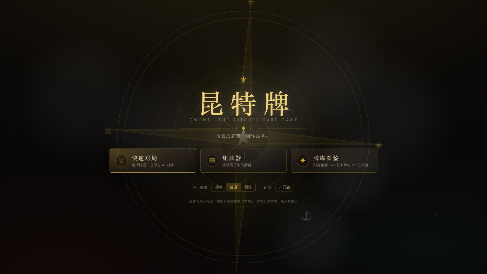
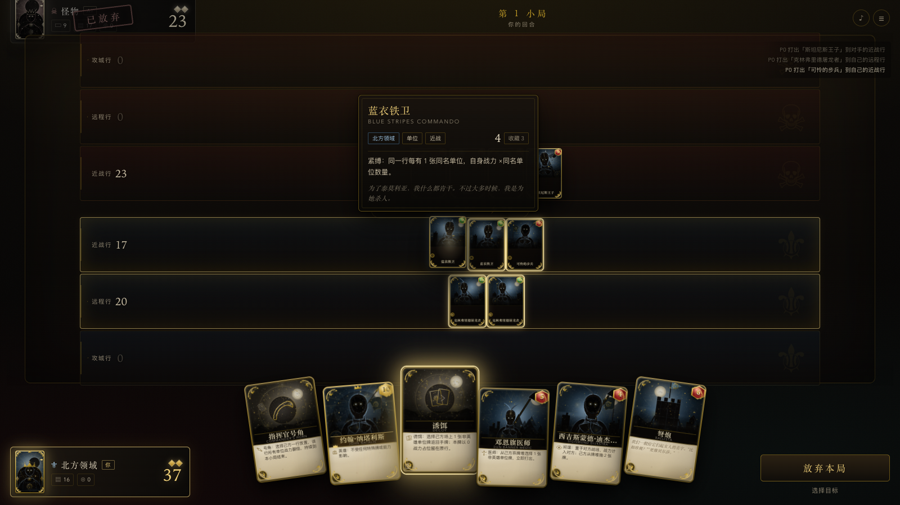
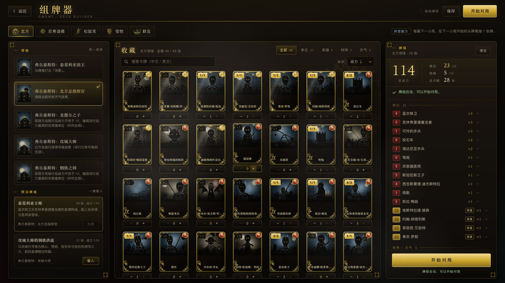

# 昆特牌 · GWENT — Web Edition

> 🎮 **在线试玩（GitHub Pages）**：<https://weixshaw.github.io/gwent-web/>
>
> 打开即玩，无需安装；第一次点击后解锁音效。

> 《巫师3：狂猎》昆特牌（含 石之心 / 血与酒 / 次世代 4.0 内容）的网页复刻：**完整规则、完整牌库**，并重新设计了牌面美术、交互与战斗特效。
> 纯原生 ES Modules + HTML/CSS，**无构建步骤、无第三方运行时依赖、无外部图片/音频素材**。所有牌面插画由程序化 SVG 生成，音效由 WebAudio 实时合成。



## 快速开始

### 方式一：在线玩（推荐）

直接打开 <https://weixshaw.github.io/gwent-web/>。

### 方式二：本地运行

```bash
npm start          # 启动静态服务器 → http://127.0.0.1:8788
npm test           # 运行全部单元测试（引擎/规则/数据/AI）
node scripts/e2e.mjs --mode=full   # Playwright 浏览器端到端（需本机 Playwright/Chrome）
```

打开 <http://127.0.0.1:8788> 即可游玩（桌面端 Chrome/Safari/Edge，建议全屏 1280×720 以上）。

## 已实现内容

### 规则（完全还原 W3 昆特牌）
- 三局两胜 / 宝石制；平局双方掉宝石；尼弗迦德平局获胜；双方尼弗迦德按普通平局。
- 开局 10 张手牌 + 换牌（至多 2 张）；**小局之间不抽牌**；先手规则（硬币 / 松鼠党指定 / 获胜方先手 / 平局原先后手）。
- 三行战场（近战/远程/攻城）、天气（严寒冰霜/浓雾/暴雨/史凯利格风暴/晴朗）、号角、曼陀罗、诱饵、灼烧、间谍、医师、集结、紧缚、士气、灵巧、英雄、复仇者、狂战士变身等全部机制。
- 5 大阵营被动：北方（胜局抽牌）、尼弗迦德（平局获胜）、松鼠党（决定先手）、怪物（随机留场）、史凯利格（第三局墓地复活 2 名非英雄）。
- 22 位领袖与全部领袖能力（含被动：白焰取消、间谍翻倍、半天气、随机复活、多抽一张等）。
- 牌组构筑：≥22 单位牌 / ≤10 特殊牌 / 1 领袖；只能使用本阵营 + 中立卡；份数受收藏限制。
- 卡牌结算顺序、英雄免疫、天气/紧缚/士气/号角叠加等与 W3 原作一致，并有一份可审计的[规则文档](docs/GAME_RULES.md)。

### 牌库（163 张卡 + 22 领袖）
- 怪物 35 / 尼弗迦德 29 / 北方领域 25 / 松鼠党 23 / 史凯利格 27，中立 24（含 5 张天气牌）。
- 含《石之心》卡牌（冈特·欧迪姆、欧吉尔德的变体、蟾蜍王子、牛、牛之防御部队等）、《血与酒》史凯利格全套，以及次世代 4.0 的 Roach 与杰洛特/希里的集结。
- 4 张召唤衍生物（牛之防御部队、赫姆达尔、变身维尔德卡、变身年轻维尔德卡）不可收藏、不可入组，但可被复仇者/曼陀罗召唤。
- 每张卡含官方英文名、中文名、能力中英文、风味文本与程序化美术参数。

### 玩法与表现
- **AI 对手**：简单 / 普通 / 困难三档。困难档对关键动作做 1-ply 模拟推演；会打间谍、按收益使用天气/号角/灼烧/医师/诱饵、管理手牌与宝石、决胜局抢分/无望局止损。
- **组牌器**：5 阵营收藏、领袖选择、筛选/搜索/排序、份数控制、实时合法性校验、10 套预设、按阵营本地保存（localStorage）。
- **牌库图鉴**：163 张卡 + 22 领袖 + 6 阵营卡背，可按阵营/类型/关键词筛选。
- **牌面美术**：每张卡确定性生成独立插画（阵营纹章、剪影、场景、粒子、暗角），英雄金框 + foil 流光，六阵营卡背，五档尺寸，悬停 3D tilt 与高光。
- **战斗特效**：出牌飞行拖尾、天气粒子（霜/雾/雨/风暴闪电）、号角金纹、灼烧火线、间谍烟雾、医师灵魂、集结分身、复仇者碎裂重生、小局/胜负横幅、胜利金雨等；粒子池封顶 800，尊重 `prefers-reduced-motion`。
- **音效**：29 种 WebAudio 合成音效 + 低频环境音，支持静音；首次交互后解锁。
- **其他**：中文 UI、卡牌详情 tooltip、对局日志、牌堆/弃牌堆检视、再来一局、规则提示。




## 操作

| 操作 | 说明 |
|---|---|
| 点击手牌 | 选出牌；灵巧/间谍/号角/曼陀罗/诱饵等会高亮可选行或目标，再点击行/目标确认 |
| 点击「放弃本局」 | Pass（会二次确认） |
| 点击领袖卡 | 使用领袖能力（可用时发光） |
| 悬停卡牌 | 显示完整能力/风味 tooltip |
| 点击牌堆/弃牌堆 | 查看剩余数量 / 弃牌堆内容 |
| Esc | 取消选牌 / 返回 |
| 右上角 ♪ / ☰ | 音效开关 / 对局菜单 |

## 技术结构

```
index.html / server.mjs / src/
├── data/      卡牌、领袖、阵营、预设牌组、牌组校验（163 张卡逐字段与参考数据一致）
├── engine/    规则引擎（确定性，可 clone 推演）、AI、随机数、计分
├── ui/        对局界面、菜单、卡牌渲染、程序化美术、特效、音效、组牌器、tooltip
├── styles/    设计 token、对局/菜单布局、卡牌样式、特效样式、组牌器样式
└── main.js / app.js  入口与控制流
tests/         引擎/数据/AI 单测 + E2E 包装
docs/          规则、架构、数据、美术方向、QA 审计
research/      原始牌库数据抓取与参考 JSON（审计用）
demo/          卡牌画廊、特效页、组牌器独立演示
```

- **规则引擎**（`src/engine/engine.js`）：DOM-free、确定性（seed 随机）、事件流驱动 UI/特效；支持 `clone()` 供 AI 推演。
- **数据契约**：卡牌 id 与结构化能力（`ability: [{id:'muster',group:'Crone'}]` 等）是引擎/UI/AI/测试共同语言。
- **可测试性**：共 106 个 Node 测试（其中 E2E 默认跳过）+ Playwright 全流程 E2E；E2E 报告见 `research/qa/e2e-report.json`。

## 测试与验证状态

- `npm test` → 104 通过 / 2 跳过（E2E 默认跳过）/ 0 失败。
- `node scripts/e2e.mjs --mode=full` → 首页 → 选阵营 → 开局 → 换牌 → 出牌/目标选择 → Pass → AI 回合 → 三小局 → 结算 → 结果页；控制台 0 error、0 pageerror、0 HTTP 4xx/5xx。
- 数据独立审计：163 卡 / 22 领袖 / 10 套预设与参考数据逐字段 0 差异。
- 规则审计：`docs/QA_RULES_AUDIT.md`（58 条逐条核对，全部裁定并落实）；独立引擎核验 23/23。
- QA 最终验收：全流程 E2E + 双分辨率可玩性巡检 **26/26 通过**，无 console 错误/页面异常/资源 4xx；截图见 `research/qa/final/`。

## 关于还原度与版权

- 本项目为**非官方粉丝作品**，不包含《巫师》系列的官方美术、音频或文本资源；牌面插画与音效全部程序化生成。
- 卡牌名称、数值、能力文本参考社区整理的《巫师3》昆特牌数据（witcher.fandom.com、aboe026/witcher-3-gwent-list 等），用于规则还原与研究目的。
- 《巫师》系列、昆特牌相关商标与版权归 CD PROJEKT RED 所有，本项目与官方无关联。

## 已知限制 / 后续可做

- AI 为启发式 + 浅层推演，非顶尖博弈 AI；后续可做更强的搜索/自对弈调参。
- 程序化美术同一 motif 内共享剪影原型（通过组合变化区分），若追求"每张独立构图"可继续扩展画师库。
- 目前为单机 vs AI，不含联机/账号/战绩系统。
- 音频需一次用户手势后解锁（浏览器自动播放策略）。

---

**致谢**：CD PROJEKT RED 创造了昆特牌；社区 wiki 与开源数据整理者提供了可靠的牌库参考。愿昆特牌与你同在。

## License

代码以 [MIT License](LICENSE) 开源（Copyright © 2026 William XIAO）。
《巫师》系列与昆特牌的商标、角色、卡牌名称与相关设定版权归 CD PROJEKT RED 所有；本项目为非官方粉丝作品，不含官方美术/音频资源。
